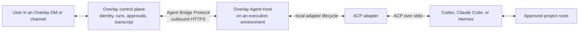
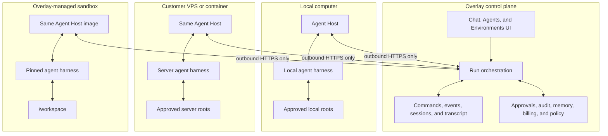
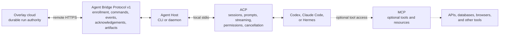
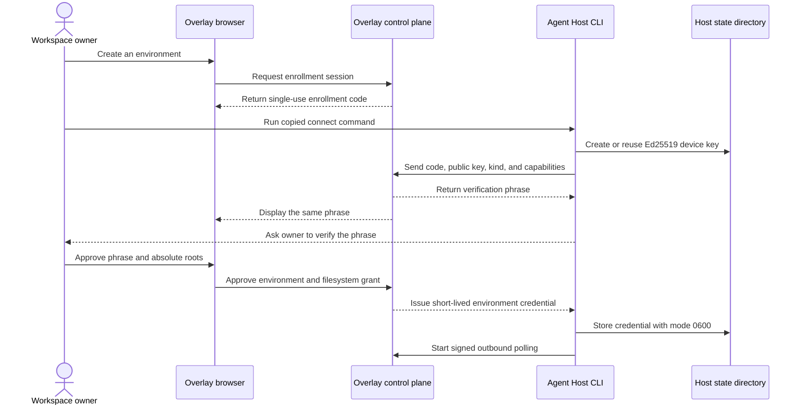
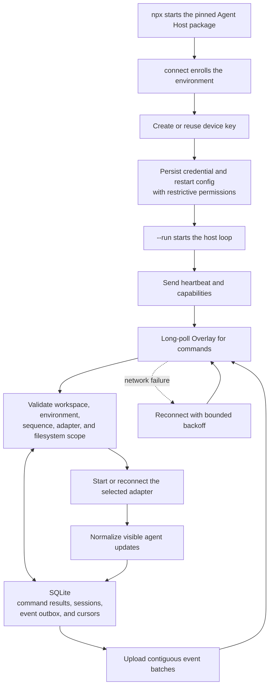
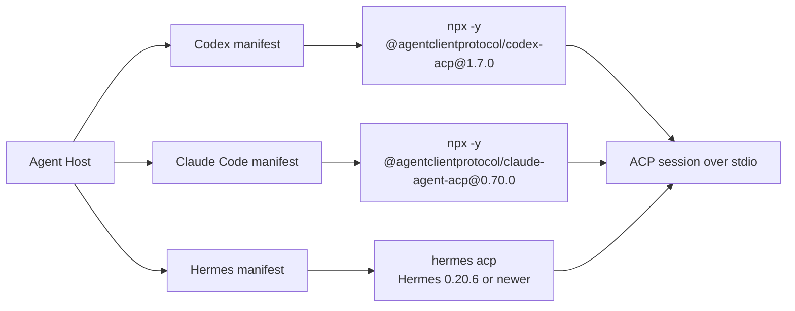
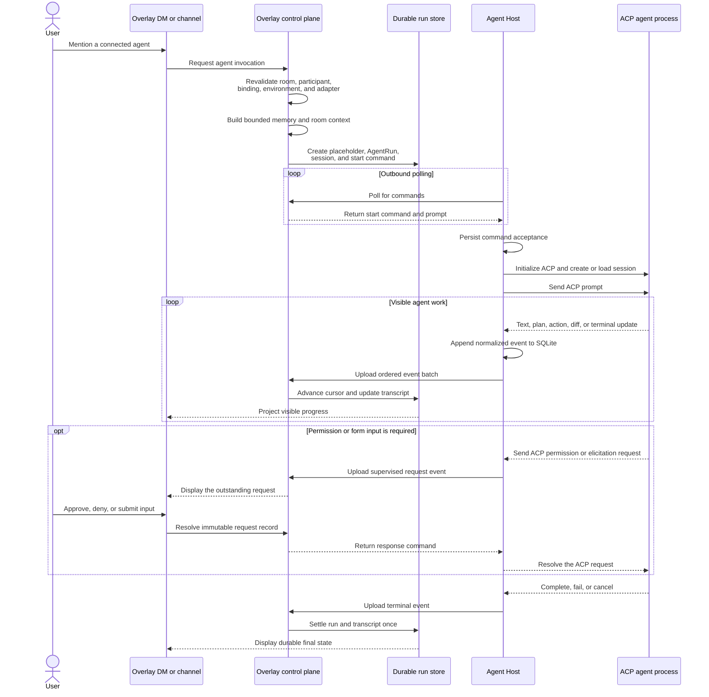
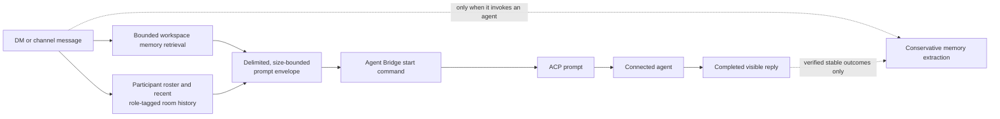

# Bring Your Own Agents

This is the living design for agents connected from user-owned computers, customer VPSs,
hosted agent services, and Overlay-managed sandboxes. The rollout is provider-neutral:
Convex is the canonical backend. Historical PostgreSQL rollout notes below describe retired implementation phases, not a second lifecycle authority.

See the [Architecture](#architecture) section for diagrams of the environment topology, protocol
layers, enrollment, Agent Host loop, ACP adapters, durable run flow, memory, and package
boundaries.

## Release boundary

The first release supports agent conversations and supervised work through one outbound-only
Overlay Agent Host. ACP is the primary coding-agent adapter; bounded eve and native adapters
may normalize into the same protocol. Environments are `local`, `vps`, `overlay_cloud`, or
`external`. Overlay Cloud uses Boat, formerly Box, with an E2B adapter for self-hosting; Vercel
Sandbox and Daytona were removed. Overlay Cloud agents use the same Agent Host
(`internal/plans/OVERLAY_CLOUD_AGENTS_PLAN.md`), with machine provisioning and the product UI behind
`OVERLAY_FEATURE_OVERLAY_CLOUD_ENVIRONMENTS`, paid entitlements and provider configuration. The
connected (on-your-machine) path described here is unaffected.

The release includes `@mention` invocation, durable runs and commands, streamed transcript
projection, approval/elicitation, cancellation, reconnect/resume, artifacts, audit, policy,
and billing. It explicitly excludes remote desktop, unrestricted terminals, general file
browsing, port forwarding, browser DevTools, implicit home-directory access, and
cross-workspace agent commerce.

An environment is an execution boundary such as one computer, VPS, container, or managed
sandbox. It is not an agent and it is not a folder: one environment may expose multiple
adapters and agent bindings. Filesystem authority is a separate explicit grant. A host may be
granted several selected roots, or the user may deliberately choose `all_user_files`, which
inherits only the files available to the host's OS account. The host never converts an omitted
grant into home-directory access. Managed sandboxes may default to one agent for operational
simplicity, but neither the protocol nor persistence schema enforces that cardinality.

## Implementation status

Phases 0 through 8 are implemented. Phase 9 release controls and repeatable local evidence are
implemented, but Phase 9 is not complete until the live Convex and PostgreSQL browser matrices,
managed-provider conformance, and production stability gates are recorded.
Overlay Cloud activation remains
gated on the configured provider's live conformance and current host/image acceptance; Phase 7 release remains gated on publishing the host packages and passing a clean VPS
conformance run against staging. The connected-agent repository now includes command
acknowledgement, immutable approval resolution, managed-lease lifecycle, binding/session scope
validation, and a shared positive and negative provider contract. The contract passes against
an in-process Convex runtime; the PostgreSQL suite uses a migrated real database and is the
required live gate whenever the local or remote contract database is available.

Phase 2 is implemented in two public AGPL-3.0-only workspace packages:

- `@layernorm/overlay-agent-bridge-protocol` owns protocol version 1, strict Zod command/event schemas,
  payload and batch limits, contiguous sequence validation, acknowledgements, capabilities,
  and explicit filesystem grants.
- `@layernorm/overlay-agent-host` owns Ed25519 device keys, environment- and workspace-scoped SQLite command
  deduplication and durable event outbox state, bounded outbound HTTP polling, reconnect backoff, backpressure, diagnostics,
  redacted JSON logs, adapter discovery/lifecycle, the deterministic fake adapter, and the
  official ACP TypeScript SDK adapter. A pristine host state store adopts the server's command
  stream position on first delivery (a previous host incarnation may have consumed earlier
  sequences); once a cursor exists, out-of-order commands still fail closed as replays.

The host executable supports `connect <code> --server <origin>`. The agent editor emits a single
harness-specific command with `--adapter <id> --run`; the same command works on a local computer,
VPS, or customer sandbox. It creates or reuses an Ed25519 device key, displays the same short
phrase shown in Overlay, waits for browser approval, stores
the resulting short-lived credential in a mode-0600 connection file, signs every control-plane
request, and rotates credentials before expiry. A named environment-variable credential remains
available for operational compatibility. Conformance tests cover start, stream, approval, cancel,
duplicate delivery, out-of-order rejection, fresh-state stream adoption, server outage, host
restart, reconnect/resume, and an actual ACP subprocess exchange.

Phase 3 enrollment begins in Agents > New agent > Bring your own agent. The user selects a harness
and either reuses an approved environment, creates one outbound connection for a local computer,
VPS, or customer sandbox, or provisions Overlay Cloud. Settings > Environments remains the fleet
administration surface for pending approval recovery, health, scope changes, listing, and
revocation. Workspace owners and admins can create a ten-minute, single-use enrollment code and
approve a pending host with one or more absolute project roots. Public host routes
never accept browser-session authority. Initial issuance requires the one-time challenge plus an
Ed25519 signature; subsequent calls require an opaque 15-minute credential and a signature over
the exact method, pathname and query, body hash, timestamp, request nonce, and token hash.

Canonical routes are `/api/v1/agent-environments`, `/enrollment-sessions`, `/enroll`, and the
environment-scoped `approve`, `roots`, `revoke`, `credentials`, `credentials/refresh`, `heartbeat`,
`capabilities`, `commands`, command acknowledgement, and `events` subresources. Enrollment-code,
challenge, credential, and request-nonce consumption is atomic in Convex and PostgreSQL. Only
hashes of enrollment codes, proof challenges, opaque credentials, and request nonces are stored.
The Convex credential validator derives its method allowlist from the canonical workspace
contract so artifact upload authority and future method additions cannot drift by provider.
Revocation cancels unclaimed work, revokes active credentials, disables bindings, and moves live
managed leases to immediate cleanup.

Phase 4 routes an agent with an enabled binding through the existing room mention path. Mention,
room membership, agent participation, binding, environment scope, and the host's advertised ACP
adapter are revalidated before dispatch. PostgreSQL and Convex each use one provider transaction
to create the existing assistant placeholder, a `remote` AgentRun, its remote-session record, and
one start command. The payer allowance check happens before that transaction; a non-null billing
reservation is released if the transaction cannot commit and its idempotency key is the
message-agent invocation nonce. User-owned ACP model execution is not charged as Overlay model
usage.

Host event batches advance the remote cursor and project full Markdown checkpoints plus stable
action parts into that one assistant message in the same transaction. Session start binds the
harness session ID; completion, failure, and cancellation settle the session, run, message,
command, token metrics, and existing conversation event exactly once. Duplicate terminal batches
return the existing acknowledgement and never append a second transcript row. Interactive offline
mentions have a two-minute claim window and visibly render `Waiting for <environment>` with Cancel
and Retry; expired leases cannot be claimed.

Agent DMs and channels use the same per-message memory policy for hosted and connected agents.
Memory defaults on only when an agent participates in the room; the composer switch disables both
recall and extraction for that turn. An invoked agent receives bounded workspace memory, hybrid
retrieval, the participant roster, and recent role-tagged room history. ACP transports this context
inside a delimited, size-bounded prompt envelope so existing protocol-v1 hosts remain compatible.

ACP session surfaces pass through to the composer when an agent advertises them. The host forwards
`available_commands_update` as a `commands_update` bridge event; the shared projection stores it as
a `data-remote-agent-commands` part on the run's assistant message, and the DM composer renders
those commands as a slash menu (selecting one fills `/name ` into the input — ACP unstructured
semantics keep the command and its trailing input in the prompt text). Agents that never advertise
commands simply show no menu; Overlay renders only what the protocol advertises and never writes
agent configuration outside ACP. Session modes and config options follow the same pass-through
pattern in later slices.
Only an agent-triggering human message is eligible for human-owned extraction; ordinary human-only
room chatter is never silently ingested. A completed agent reply may produce conservative,
agent-owned memories for explicit decisions, verified outcomes, stable project facts, and reusable
constraints. Suggestions, private reasoning, secrets, and unverified action claims are excluded.
Both Convex and PostgreSQL validate the exact workspace, room, message, author kind, and memory
owner before scheduling extraction; duplicate deliveries remain idempotent.
Extraction prompts may include bounded prior messages by that same human or exact agent principal,
but never messages authored by other room participants. Room-wide context is reserved for the
invoked agent turn and is not implicitly forwarded to the separate memory-extraction model.
The PostgreSQL memory and memory-index `user_id` columns are legacy-named opaque owner identifiers,
not human-user foreign keys. Human account deletion removes human-owned rows explicitly; agent
rows remain attributed to the stable `agent-memory:<agentId>` principal within their workspace.
The database also keeps a user-delete compatibility trigger so older runtimes retain the prior
cascade behavior during a rolling upgrade or rollback.

Bindings are managed through `/api/v1/agent-bindings` and remain separate from agent identity.
The Agents directory derives its connected-harness label from the active binding rather than the
agent's historical model ID, so agents created before the BYO editor still display their actual
runtime.
The agent editor starts with an explicit `Create your own agent` versus `Bring your own agent`
choice. The BYO branch is rendered only after a workspace-scoped connected-agent request succeeds;
deployments with the global flag disabled and workspaces outside the active rollout stage stay on
the normal Overlay-agent editor instead of exposing a form that can never submit.
Overlay-only instructions, model selection, and tool grants never appear in the BYO branch. The
BYO branch selects the harness first, filters approved environments by advertised ACP adapter, and
records an explicitly granted default working directory. Creating an environment stays inside the same editor
and returns directly to the binding step after phrase and root approval. A failed
binding retry edits the already-durable agent identity rather than creating a duplicate. The host
ships data-only manifests for Codex (`@agentclientprotocol/codex-acp@1.7.0`) and Claude Code
(`@agentclientprotocol/claude-agent-acp@0.70.0`). Hermes 0.20.6 or newer is a third built-in target
through the official `hermes acp` stdio server. It uses the unchanged ACP lifecycle for session
creation/loading, streamed message and tool updates, permissions, cancellation, and authentication;
the host does not translate Hermes through a private protocol. Adding another ACP target extends the
manifest and conformance fixtures, not conversation orchestration. The built-in user-owned adapter
IDs live in
`@overlay/workspace-contracts`; they are deliberately separate from the managed-sandbox adapter
allowlist so enabling a local or VPS adapter never makes Overlay Cloud eligible.
PostgreSQL migration 0066 repairs older databases whose recorded migration history omitted the
nullable conversation-message edit-history column required by the shared transcript writer.

Phase 5 completes the supervised-work contract. ACP permission requests and form elicitations
become immutable, workspace-scoped request records and structured message parts. Resolution
rechecks active human membership and room participation, accepts only an outstanding option or a
schema-valid form response, and emits one idempotent response command; a host cannot resolve its
own request. Room controls propagate cancellation to the harness and expose recovery as explicit
`Resume` and `Start fresh` actions backed by the persisted remote session and original start
payload. The agent principal remains the message/action actor while the summoning human remains
the initiator and billing source.

ACP plans, file diffs, terminal references/summaries, tool actions, and Markdown checkpoints are
stored as structured parts on the existing assistant row. Artifact intents create five-minute,
run/environment/workspace-scoped object-store uploads capped at 25 MiB. Completion verifies exact
type and size, recomputes SHA-256, rejects EICAR and executable signatures, and makes only clean
artifacts linkable through a participant-authorized short-lived download redirect. Artifact rows
expire after 30 days and cleanup deletes the object before tombstoning metadata. PostgreSQL runs
cleanup in its maintenance worker; Convex schedules an internal-secret BFF cleanup bridge because
object-store credentials remain on the application host. Convex deployments therefore require
`OVERLAY_BFF_URL` and the same `INTERNAL_API_SECRET` as the corresponding web deployment.

The terminal run event is authoritative for visible tool lifecycle. Completion, failure, or
cancellation closes any remote action or attached terminal that the harness left in a running
state. The renderer applies the same rule to older persisted transcripts so finished work never
keeps an in-progress shimmer after refresh.

Remote leases are extended only by accepted contiguous events. Convex supervises expired or
disappeared hosts every minute; the PostgreSQL background worker performs the same bounded sweep.
Both project a recoverable state, cancel outstanding commands, close pending requests, and settle
or reconcile the original billing reservation exactly once. PostgreSQL migration 0067 adds
request kinds and artifact metadata. The shared provider contract now covers artifact tenancy,
validation state, retention cleanup, and idempotent tombstones.

The managed-sandbox boundary is `@overlay/sandbox-runtime`. Its contract covers
lifecycle and reconnect, streamed and cancellable commands, files, process environment, ports,
snapshots and persistence, network policy, broker-owned credential references, idle and hard
timeouts, usage, capability flags, and an explicitly operator-only raw SDK handle. Box is the
Overlay Cloud adapter, and an E2B adapter is implemented for self-hosting. Provider SDK objects and references are never public response fields.
The lease meter (`ManagedAgentSandboxBilling`) bills a lease from provider-reported usage and
enforces the idle window and the 24-hour hard cap; Box has no idle timer, so idle-stop is ours.

**Removed: managed harness agents.** Earlier phases ran AI SDK HarnessAgents (Claude Code, Codex,
OpenCode, Pi, Hermes) inside Vercel Sandbox (`managedHarnessAgentTurnWorkflow`,
`agentHarnessSessions`), provisioned through `POST /api/v1/agent-environments/managed`. That path,
its Vercel adapter, the harness bridge, the editor's runtime picker, and the reset endpoint were
deleted. `protocol: 'harness'` bindings that still exist in data are inert: dispatch posts a failed
reply asking the user to recreate the agent, the editor shows such an agent read-only, and the
control plane refuses new harness bindings. Hosted other-agents (Claude Code, Codex, … on Overlay
Cloud) use the new Boat machine service, or E2B for self-hosted deployments; the
connected-agent protocol below is the foundation, supporting an Overlay-owned
machine running the Agent Host.

Overlay Cloud model access follows a fixed priority. Overlay-funded models are the default and
lowest-friction path. BYOK/API keys are the first customer-owned authentication path and are
brokered at execution time rather than embedded in images, snapshots, commands, or transcripts.
Provider-specific browser or device login may be added only when that provider officially supports
a remote or headless flow. Overlay never copies, mounts, uploads, or imports a user's local Codex,
Claude, or equivalent authentication directory into a managed sandbox.

Phase 7 makes `@layernorm/overlay-agent-host` and `@layernorm/overlay-agent-bridge-protocol` publishable packages and
requires Node.js 24. The first production package line is `0.1.0`; Hermes support was released in
the lockstep `0.2.0` package line under the shorter legacy names. The product-qualified public
package names begin with lockstep `0.3.0`; the current PATH-safe release line is lockstep `0.3.5`. The application copies an exact
`npx --yes --package node@24 --package @layernorm/overlay-agent-host@0.3.10 overlay-agent-host ...`
command rather than following npm `latest` or inheriting an unsupported system Node runtime. The host and
protocol packages release together, the host depends on the exact protocol version, and the npm
release workflow publishes compiled ESM plus declarations for both packages with provenance after
the compatibility, package-content, and clean Node.js installation gates. Published package entry
points never require TypeScript stripping or a consumer-supplied loader. The release workflow leaves
the legacy `@layernorm/agent-host` and `@layernorm/agent-bridge-protocol` releases installable and
deprecates them with migration guidance only after the `0.3.0` packages publish successfully.
Enrollment atomically saves a mode-0600 restart configuration beside the private credential state.
The same executable runs as a foreground CLI, a per-user macOS LaunchAgent, a restartable systemd
service, or the default process in the Agent Host container. The macOS service command uses the
pinned Node 24 and host package versions, survives Terminal closure, restarts after login or
process failure, and persists a sanitized executable search path so adapters installed under
user-level locations such as `~/.local/bin` remain available to `launchd`. The documented VPS and Docker shapes expose no
inbound port and persist SQLite/device state across restarts and upgrades. The hardened systemd
unit runs under a dedicated OS account; operators must align `ReadWritePaths` with the exact roots
approved in Overlay.

The bounded Eve adapter uses only the public `eve/client` session API and durable event stream. It
is pinned to Eve 0.44.4 while Eve is preview. Overlay projects visible message checkpoints,
actions, usage, terminal state, and pending input requests, never private reasoning. Approval and
elicitation replies are checked against the outstanding Eve request, and the host persists the Eve
session ID, stream cursor, visible text accumulator, and usage accumulator after every event. A
reconnect without that cursor fails closed and requires the deliberate `start fresh` path. The Eve
service should run beside the host on loopback or a private network; Overlay does not require it to
be publicly reachable. Eve connection
authorization (`authorization.required`) is not bridged by the current host contract, so the
adapter fails that run closed instead of leaving an OAuth pause unobservable. Use static or
app-scoped Eve connection auth until a dedicated authorization capability is added.
Hermes uses its official ACP server. OpenClaw and other native adapters remain ineligible unless ACP
is unavailable and the unchanged host conformance suite passes.

Phase 8 uses one entitlement-derived policy for both persistence providers. Environment redemption
rechecks the enrollment-time environment ceiling atomically; remote dispatch atomically enforces
workspace concurrency and one active run per managed environment. Hard run deadlines cap lease
renewal. Event uploads use per-environment minute windows, and artifact creation reserves workspace
bytes before issuing an object-store URL. Free, paid, and max plans also bound idle time, sandbox
egress, and managed runtime; the existing billing ledger remains the monthly-spend gate.

Host-side BYOK model tokens remain observable but never become Overlay model usage. A local or VPS
environment has no sandbox reservation. Overlay Cloud creates a distinct pre-dispatch `sandbox`
reservation under `agent:<agentId>` in addition to any explicitly Overlay-funded model reservation.
Actual Box usage settles the provider-reported dollars (falling back to the rate card on billable
seconds). The reservation ledger is the exact-once boundary, and an unavailable
provider or failed usage read moves the reservation to reconciliation instead of guessing at a
charge. `OVERLAY_SANDBOX_MAX_PROVIDER_COST_USD_PER_RUN` rejects an estimated run above USD 15 by
default before provider work starts. A durable settlement marker is created atomically with each managed run and is cleared only
after the idempotent usage ledger and lease usage record both succeed. PostgreSQL maintenance retries
pending markers directly; the Convex scheduler calls the internal BFF reconciliation route so
provider credentials never move into Convex. `OVERLAY_SANDBOX_PROVIDER_SPEND_ALERT_USD` controls the
per-run provider-spend warning threshold and defaults to USD 10. Provider account-level spend alerts
and limits remain mandatory because provider storage and aggregate monthly overages are not visible
in a single run's SDK counters.

Every dispatch and accepted cursor checkpoint writes a redacted audit record correlated by
workspace, agent, environment, run, command, remote session, provider reference, reservation, and
event cursor. Immediate alerts cover cursor gaps, settlement and artifact-cleanup failure, and high
provider spend. The one-minute supervisor also reports offline environments, expired leases, stuck
commands, aged approvals, and failed sandbox cleanup. PostgreSQL maintenance prunes event-rate
windows; Convex performs the same cleanup through its scheduled mutation.

Phase 9 adds a fail-closed workspace rollout independent of the three incident kill switches.
The PostgreSQL browser smoke treats console errors as failures in addition to page errors and
network/WebSocket activity. Convex subscription hooks must live in provider-gated bridge components;
passing `"skip"` to `useQuery` still requires a mounted `ConvexProvider` and is therefore not a
valid PostgreSQL fallback. The signed-out variant ignores only the browser's generic 401/403 resource
messages; authenticated QA and all JavaScript/runtime console errors remain fail-closed.
`OVERLAY_CONNECTED_AGENTS_ROLLOUT_STAGE` progresses through `off`, `internal`, `invited`, and
`general`. Internal workspaces come from `OVERLAY_CONNECTED_AGENTS_INTERNAL_WORKSPACE_IDS`; the
invited stage additionally includes `OVERLAY_CONNECTED_AGENTS_INVITED_WORKSPACE_IDS`. A workspace
outside the active stage cannot create or manage environments and cannot dispatch a new remote run.
Existing host credentials remain governed by the global control-plane kill switch so operators can
choose between stopping new tenant dispatch and immediately stopping the entire fleet.

The repeatable local release gate is `npm run check:byo-agents:release`. It covers unit, protocol,
host crash/reconnect, Convex repository, authorization, billing, route inventory, migration-version,
no-Convex PostgreSQL bootstrap, bounded command/event/fan-out load, managed sandbox, and cleanup
tests. Host compatibility runs in GitHub Actions on
macOS 14, Ubuntu 24.04, and Windows Server 2022. These automated checks do not replace authenticated
browser QA, live provider conformance, invoice reconciliation, or production soak evidence.

The 2026-08-25 release rehearsal at staging runtime commit `c0e56958e` passed that gate and the full
configuration, TypeScript, and isomorphic-boundary checks. Convex dev `different-caiman-77` served
the allowlisted internal workspace through `staging.getoverlay.io`; authenticated Chrome QA loaded
its environment inventory without fresh console errors. GitHub Actions run `32828571507` passed on
macOS 14, Ubuntu 24.04, and Windows Server 2022. PostgreSQL deployment
`dpl_42BEd1gxBJ3UTRbWoVYH5mfTTfDb` migrated to schema 68 and passed both connected-agent provider
contracts. Runtime deployment `dpl_FLjfy6pSMRx5vpmQJ5wgShyxkswR` passed the strengthened signed-out
browser matrix across the public shell, sign-in, chat, and environment settings with zero Convex
connections and zero JavaScript/runtime errors; fresh Chrome tabs loaded both provider surfaces
without console errors. The unauthenticated enrollment boundary matched Convex at HTTP 401. This is
a release baseline, not Phase 9 completion.

The PostgreSQL release deployment must enable the provider-neutral workspace, agent, room, and
conversation routes as well as the connected-agent control plane. A signed-out 401/403 matrix is
insufficient: authenticated QA must create its Personal workspace, load Environments, and
exercise the same enrollment-to-mention flow without any Convex request.

Deployment `dpl_HsV4gn8EmABm75xATvxbTkeg1uiE` passed the authenticated PostgreSQL shell matrix for
the Personal workspace, Agent Environments, Agents, and Chat. The browser resource inventory
contained no Convex URL, emitted no runtime error, and the server no-Convex bootstrap and release
safety suites passed. The same rehearsal found and repaired a stale route-support gate that had
incorrectly hidden provider-neutral workspace collaboration routes in PostgreSQL mode.

Artifact release evidence includes an accelerated bounded-batch soak: more than two cleanup pages
of expired objects must drain exactly once, tombstones must remain idempotent, and unexpired objects
must survive. This deterministic rehearsal complements rather than replaces the calendar-time
production retention observation.

Live sandbox conformance uses the strictest portable lifecycle constraint shared by the supported
providers. Resume the original persistent sandbox before deleting its snapshot, then delete the
snapshot explicitly during cleanup.

The 2026-08-25 live conformance run passed for Vercel Sandbox and Daytona (both since removed). Phase 9 remains open
until the fresh enrollment-to-mention matrix, provider-invoice reconciliation, calendar-time
artifact-retention observation, and matching production Convex rollout and stability evidence are
complete.

## Overlay workspace tools for connected agents

A connected agent gets the same Overlay workspace tools a native agent with the same grant gets —
notes (including the patch-style `edit_note`, `replace_note_section`, and `append_to_note`), files
(`list_files`, `read_file`, `write_file`, `create_folder`, `move_file`), memory, knowledge search,
automations, connected apps, and MCP servers — built by the same pipeline (`buildWorkspaceAgentTooling`:
the agent's grant intersected with workspace policy, entitlements, and the summoning message's
mutation gating). Tools act as the human who summoned the agent (the delegate model). Tools that
duplicate the agent's own machine (`computer_*`) and generated UI are
withheld. An MCP call whose server policy requires approval asks in the run's conversation
(`createMcpApprovalGate`, `requestMcpApprovalByServer`): the same approval card an agent's own
permission request shows, but the answer goes to the waiting call and never to the host as a command
(`resolveRemoteRequestByServer` skips the host command for requests marked `source: overlay_mcp`). The
call waits about 25 seconds, since agent hosts time MCP calls out in about a minute; if the person has
not answered it returns "waiting for approval, call again with the same arguments", and the answer
(remembered for the run, per tool and arguments) makes the retry run at once. A denial or the run ending
refuses. Overlay skills are also offered as MCP prompts (Claude shows them as slash commands), so no
writes into the harness's own skill folders are needed. `MCP_GROUP_COVERAGE` (`src/shared/mcp/access.ts`)
records, per tool group, whether it reaches MCP clients or why not, and a contract test fails when a
group is added without being placed.

- **Connected agents** receive an MCP server. The remote-turn start command carries
  `metadata.overlayMcp = { url: <app origin>/api/agent-mcp, token }`; the Agent Host passes it to ACP
  `session/new`/`session/load` as an HTTP MCP server with an `Authorization: Bearer` header, only when
  the runtime advertises `mcpCapabilities.http` and the URL is HTTPS (or localhost). The token
  (`ovmcp_…`, `src/server/agents/agent-mcp-token.ts`) is HMAC-signed with
  `OVERLAY_AGENT_MCP_SECRET` (falling back to the service-auth secret), scoped to one run, expires
  after the run-time cap plus slack, and is refused as soon as the run's remote session is no longer
  live. Older hosts ignore the metadata key, so no protocol version change was needed; a published
  host release is required for connected agents to use the tools.


- Overlay owns workspace identity, authorization, `AgentRun`, commands, approvals, budgets,
  transcript projections, audit, and artifact policy. A host owns only private harness state,
  its SQLite outbox, and remote session identifiers.
- Hosts make outbound HTTPS connections only. Enrollment credentials and subsequent service
  credentials are environment- and workspace-scoped, short-lived, revocable, method-bound,
  and never grant general user-session authority.
- Host text, tool state, metadata, and artifacts are hostile input. Validate versions, sizes,
  sequences, payload schemas, checksums, and authorization before projection. Never persist
  private chain of thought; retain user-visible results and concise action summaries.
- Primary threats are enrollment-code theft/replay, device-key theft, cross-workspace ID
  substitution, forged or reordered events, approval forgery, command replay, malicious
  artifacts, path traversal, secret leakage, resource exhaustion, stale-host execution, and
  revoked-host continuation. Durable idempotency, contiguous cursors, proof of possession,
  explicit root grants, scoped upload URLs, quotas, redaction, revocation, and lease expiry
  are mandatory mitigations.
- The local SQLite database and Ed25519 private key are created under an explicit state
  directory with restrictive permissions. POSIX hosts enforce `0o600` secret files and a
  `0o700` key directory; Windows hosts rely on the current user's inherited profile ACL because
  Node exposes Windows ACLs only as synthetic POSIX mode bits. Unacknowledged output is written before upload;
  acknowledged frames are removed while the per-run sequence remains monotonic across restarts.
- Selected roots authorize command working directories and the roots advertised to ACP. They
  do not claim to sandbox an arbitrary child process at the operating-system layer. Strict file
  isolation requires a restricted OS account, container, VM, or managed sandbox; the explicit
  `all_user_files` choice accurately represents an unrestricted local harness.
- A human initiator and the agent principal are distinct. Authorization and billing remain
  attributable to the initiator; messages and delegated actions are authored by the agent.

## Transport diagnostics

A run that seems stuck needs evidence from both sides. Decisions (see
`internal/plans/RELIABLE_CONNECTED_AGENTS_PLAN.md`, Phase 0):

- **Request ids.** The poll, events, ack and heartbeat routes return `x-overlay-request-id`. Host warnings for a
  failed request include it (`[request …]`), so a host log line matches the server log for the same request.
  Healthy fast polls are not logged. Failed or slower-than-3 s requests log one line with route, status and
  duration.
- **Failure classification, never messages.** The logger drops error messages and redacts keys containing `name`
  or `error`. A bare `logger.error(..., error)` therefore records nothing useful. Log
  `describeFailure(error)` instead (`src/server/observability/failure-classification.ts`). It records the error
  type, a class (`convex_occ`, `convex_limit`, `convex_timeout`, `convex_unavailable`, `convex_function`,
  `control_plane`, `validation`, …), our SCREAMING_SNAKE codes, and for Convex calls the function path and Convex
  request id. `callConvex` tags every thrown error with its function path for this purpose.
- **Run stream counters.** `applyRemoteEventsByServer` keeps `conversationAgentRuns.streamStats` (batches, events,
  bytes, `text_checkpoint` characters, message rewrites, refused batches, host-to-server lag, longest gap between
  batches, longest tool call). `GET /api/v1/conversations/run` returns them as `streamSummary`, including the
  current silence and longest still-open tool for an active run. `textCheckpointChars` divided by the final text
  length is the snapshot amplification that Phase 1 removes. A host whose outbox is wedged never reaches the
  server, so it shows up as a growing `currentQuietMs`, not as refused batches.
- **Smoke.** `scripts/smoke/cloud-agent-long-horizon/harness.mts --via overlay --preview-url <PR preview>` runs a
  real Claude Code cloud agent through the product API and reports visible progress, visible stalls (90 s with
  nothing new on screen), the counters, and with `--cancel-after-s` whether text survives Stop.

## Data classification and retention

| Data | Classification | Retention |
| --- | --- | --- |
| Public device key, host/capability metadata | workspace-confidential | Until environment deletion plus the normal deletion grace period |
| Credential hashes, nonces, enrollment records | restricted security data | Active lifetime plus 30 days of replay/audit evidence; never log raw secrets |
| Commands, lifecycle events, approvals, audit | workspace-confidential; approvals are immutable audit | Workspace retention policy; security audit minimum 90 days where policy permits |
| Transcript projections and artifacts | customer content | Existing conversation/artifact retention and deletion policy |
| Host private state and unacknowledged SQLite outbox | customer-controlled local data | Until acknowledgement; terminal session metadata may remain until host cleanup |
| Redacted operational telemetry | internal operational data | Existing metrics/log retention policy |

Workspace/account erasure cascades through environments, bindings, sessions, commands,
approvals, and leases. Object-store cleanup is reconciled asynchronously. Security evidence
required by law may be tombstoned and access-restricted rather than silently orphaned.

## Offline policy

An offline environment never appears to be working. The environment list derives its displayed
health from the most recent heartbeat: an `online` row becomes effectively `offline` after 45
seconds without a heartbeat, and the settings UI refreshes every 15 seconds while environments
exist. Interactive mentions may remain queued
for a short, explicitly displayed window; the UI must show `Waiting for <environment>` with
Cancel and Retry. Commands are durable and claim-once. Revocation prevents new claims
immediately; active credentials expire and leases terminate safely. Reconnect resumes from
acknowledged command/event cursors. Duplicate sequences are acknowledged without reapplying;
gaps are rejected with the next expected sequence. The Environments settings surface repeats
the likely cause for an offline user-owned environment (asleep machine or closed connector),
states that Overlay cannot wake it remotely, and offers the persistent-service install
command on macOS.

## Supported platforms

| Host target | First-release support | Packaging |
| --- | --- | --- |
| macOS 14+ (Apple Silicon and x64) | Supported | npm executable plus per-user LaunchAgent service commands |
| Linux x64/arm64 (current Ubuntu/Debian/RHEL-family) | Supported | npm executable and Docker; systemd follows host hardening |
| Windows 11 / Server 2022 x64 | Supported | npm executable; Windows service packaging may follow |
| Overlay Cloud Linux sandbox | Deferred and unavailable in product UI | Same host image and bridge protocol after the managed-environment release gate |
| Mobile OS, browser-only runtimes, end-of-life desktop OSs | Not supported | None |

## Rollout flags

The server-side runtime config has four independent, default-off flags:

1. `features.connectedAgentControlPlane` gates enrollment and environment management.
2. `features.remoteAgentRuns` gates command dispatch and remote `AgentRun` execution.
3. `features.connectedAgentArtifacts` gates agent artifact upload, completion, and download.
4. `features.overlayCloudEnvironments` gates managed-environment provisioning.

The environment-variable forms are `OVERLAY_FEATURE_CONNECTED_AGENT_CONTROL_PLANE`,
`OVERLAY_FEATURE_REMOTE_AGENT_RUNS`, `OVERLAY_FEATURE_CONNECTED_AGENT_ARTIFACTS`, and
`OVERLAY_FEATURE_OVERLAY_CLOUD_ENVIRONMENTS`.
They are positive, server-side switches: missing, false, or malformed values resolve to disabled.
This makes each switch an environment-controlled, fail-closed incident control. Overlay Cloud's
switch remains false for the production workspace rollout, and the agent editor does not expose a
managed-environment choice while that release is deferred.

Broad release also requires `OVERLAY_CONNECTED_AGENTS_ROLLOUT_STAGE` plus the internal and invited
workspace allowlists described above. The rollout defaults to `off`; turning on a feature flag alone
does not make any workspace eligible.

The first production activation is intentionally narrow:

- publish and independently install-smoke the exact Agent Host and bridge-protocol versions;
- set `OVERLAY_FEATURE_CONNECTED_AGENT_CONTROL_PLANE=1` and
  `OVERLAY_FEATURE_REMOTE_AGENT_RUNS=1` in production;
- keep `OVERLAY_FEATURE_CONNECTED_AGENT_ARTIFACTS=0` and
  `OVERLAY_FEATURE_OVERLAY_CLOUD_ENVIRONMENTS=0`;
- set the rollout stage to `internal` or `invited` and populate only the corresponding exact
  workspace IDs; and
- verify the public capability response, an ineligible workspace's hidden BYO editor, and a full
  eligible-workspace enroll, approve, bind, invoke, stream, cancel, reconnect, revoke path before
  widening the allowlist.

Changing a rollout variable requires a new production deployment so the immutable web runtime reads
the approved values. Roll back by setting the rollout stage to `off`; use either global feature flag
as the incident kill switch when the entire control plane or all new remote dispatch must stop.

Route services read these flags before selecting a database repository, so Convex and
PostgreSQL have identical disabled behavior. Enabling a dependent feature does not implicitly
enable its prerequisite: Overlay Cloud requires all three, and remote runs require the first
two. These are server policy switches, not client assertions; bootstrap may expose only the
resulting authorized capability.

Connected-agent artifacts remain disabled in staging and production until uploads are quarantined,
scanned in full by a production malware engine, validated by content magic, and served only as safe
attachments after an immutable clean verdict. The existing checksum, size, tenancy, retention, and
cleanup controls remain implemented but are not a substitute for that release gate.

Overlay Cloud machines run on Boat, formerly Box (`BOAT_API_KEY`, or the legacy `BOX_API_KEY`).
Use `BOAT_ENVIRONMENT=overlay-preview` with a separate environment-scoped key for
hosted Preview QA. Machine creation retains `noEnv: true`, so attaching an
environment never injects the account's credentials. Preview snapshots must also
originate in that environment; a destination grant cannot read production images.
The owner approved a Boat-specific expiry exception: the `overlay-preview` CI key
expires **2027-10-15** (Boat requires expiry, maximum 365 days). Renew it in the
same environment before that date, update shared Vercel Preview `BOAT_API_KEY`,
verify Preview access and production denial, then revoke the predecessor. Do not
copy the production key or treat the exception as permission to expire other
shared Preview credentials. No automatic renewal is configured.
An Overlay Cloud agent uses the same connected-agent protocol and host:

- **Image.** `infra/agent-image/provision.sh` adds a pinned Overlay layer (Agent Host, acpx,
  `@agentclientprotocol/claude-agent-acp`, `@agentclientprotocol/codex-acp`) on top of Boat's
  system layer and writes `/etc/overlay/image.json`. `publish-boat.mts` freezes it as the named
  snapshot `overlay-agent-v<N>` (`OVERLAY_CLOUD_AGENT_IMAGE`). The image holds no credentials and
  no enrolled identity; `overlay-agent-host image-check` enforces both and runs before a managed
  host enrolls.
- **Engine.** Managed hosts run ACP agents through acpx's runtime (`--engine acpx`,
  `AcpxAgentAdapter`). Each run's Overlay MCP server and provider credentials reach the agent
  process only; the acpx connection is closed after every turn and the session resumes on the
  next. On-your-machine hosts keep the direct ACP adapter.
- **Enrollment.** `POST /api/v1/agent-environments/cloud` mints the same single-use enrollment
  code, boots the machine, and the host redeems it with its Ed25519 key. Overlay created the
  machine, so the server approves the environment itself instead of a person confirming a phrase,
  with the filesystem grant fixed to `/home/user/workspace`. The short-lived credential, signed
  polling, and ACP bridge are unchanged.
  Managed connect/restart commands propagate lifecycle v2 only when the server
  enables it; the host persists that negotiation for subsequent restarts.
- **Lifecycle.** A machine stops 10 minutes after its last run ends
  (event-based; see `internal/develop/agent-machine-idle.md`). A turn queued for an offline machine
  resumes it and restarts the host from saved state after the response is sent. Revoking the
  environment stops and deletes the machine through the lease reaper.
- **Startup and control.** Creating a machine returns 202 and provisions after the response;
  `cloudAgentProvisions` (Convex) records the phase (queued, allocating, booting, connecting,
  ready, or failed with a safe message) so any server instance can answer
  `GET /api/v1/agents/{agentId}/machine`. That route also pauses, resumes, restarts, and deletes
  the machine (`CloudAgentMachineService.status/control/teardown`). The new-agent dialog and the
  agent page's Machine section are its only clients; a cloud agent's binding is never rewritten
  by the agent editor's save (it would drop the account). Paid plans only.
- **Provider accounts.** An Overlay Cloud agent runs on one of its creator's own accounts
  (Settings → Agent accounts): a `claude setup-token` token or Anthropic API key for Claude Code,
  an OpenAI API key for Codex. The secret goes to the credential vault (`ByokCredentialStore`:
  WorkOS Vault, or AWS Secrets Manager when configured); Convex keeps `agentProviderAccounts`
  metadata and the opaque vault reference, which no API response includes. A binding records the
  account and the user who chose it (`adapterConfig.providerAccountId`/`providerAccountOwnerUserId`).
  On each run the host calls `POST /api/v1/agent-environments/{id}/run-credentials` (credential
  method `agent:run-credentials`, issued only to `overlay_cloud` environments so published hosts keep
  parsing their credentials) and passes the result to the agent process as environment variables
  (`CLAUDE_CODE_OAUTH_TOKEN`, `ANTHROPIC_API_KEY`, `OPENAI_API_KEY`). The command carries only a
  `runCredentials` flag, never a secret; the host holds the credentials in memory, creates one acpx
  runtime per run so nothing carries over, and the control plane audits the release without the
  value. API keys are checked against the vendor when connected; a subscription token has no public
  check, so a bad one surfaces on first use.
- **Auth failures.** An agent that rejects its credentials ends the run with the failure code
  `auth_required`; the control plane marks that account `needs_reauth`, releases nothing for it until
  it is reconnected (PATCH with a new secret clears the flag), and Settings shows "Needs reconnecting".
- **Image v2.** The bridge protocol gained the run-credentials method, which v1 image hosts cannot
  parse, so images are versioned: the host accepts only the image versions it was built for
  (`SUPPORTED_OVERLAY_IMAGE_VERSIONS`) and `OVERLAY_CLOUD_AGENT_IMAGE` defaults to `overlay-agent-v5`.
- **Boat quirk.** `~/.claude` and `~/.codex` on Boat are provider-managed mounts that fail with
  I/O errors when no Boat credentials are linked; agent config therefore lives under `~/.overlay`
  (Phase 4 imports go there).

## Public resources and protocol policy

Canonical resources live under `/api/v1/agent-environments` (enrollment sessions,
enrollment/approval, environments, heartbeat, command polling, event batches, capabilities,
and revocation), `/api/v1/agent-bindings`, and the existing conversation run/approval routes.
Managed leases are a subresource of environments and are not provider-branded. Secrets,
provider references, raw harness state, and private chain of thought are never public fields.

The Overlay bridge protocol uses an integer `protocolVersion`, starting at `1`. Every event
includes `protocolVersion`, `eventId`, `environmentId`, `runId`, `sourceSequence`, `type`,
`occurredAt`, and a versioned payload. Batches must be contiguous. Projection and cursor
advance are one transaction. Servers support the current and immediately preceding version
during a documented host-upgrade window; unknown major versions fail closed with a structured
upgrade error. Additive optional fields are backward compatible, while semantic or required
field changes increment the version. WebSockets may optimize latency but durable HTTP polling
and acknowledged cursors remain authoritative.

Protocol version 1 transports `start`, `prompt`, permission and elicitation responses, `cancel`,
`reconnect`, and `shutdown` commands and normalizes session start, text checkpoints, actions,
permission/elicitation requests, plans, diffs, terminal summaries, validated artifacts,
completion, failure, and cancellation events. The HTTP client treats route URLs as
control-plane configuration; `/api/v1/agent-environments/**` is the canonical Phase 3 control
plane. Credentials are bearer-scoped by that control plane and are never included in logs.

### Publishing the Agent Host packages

`@layernorm/overlay-agent-host` and `@layernorm/overlay-agent-bridge-protocol` publish through
GitHub Actions via npm Trusted Publishing (OIDC) — no npm token exists anywhere. Bump both
package versions together (and the `OVERLAY_AGENT_HOST_PACKAGE_VERSION` pin in
`src/server/agents/agent-enrollment-command.ts`), land on `main`, then run
`gh workflow run publish-agent-host.yml --ref main -f version=<same version>`. The Trusted
Publisher registration (LayerNorm/overlay-web, `publish-agent-host.yml`, environment
`Production`) is configured in each package's Settings on npmjs.com; re-register there if the
workflow file is ever renamed. npm's 2026 bypass-2FA token restriction revoked the legacy
`NPM_TOKEN`, so the workflow must not set `NODE_AUTH_TOKEN` — with the token absent, npm uses
the OIDC exchange.

## Provider-neutral persistence contract

`AgentEnvironment`, `AgentBinding`, `AgentRunCommand`, `AgentRemoteSession`,
`AgentApprovalRequest`, and `AgentSandboxLease` are separate domain records. Agent identity,
harness adapter, environment, sandbox provider, and protocol adapter must not collapse into
one enum. The existing `AgentRun` state machine remains lifecycle authority and gains a
`remote` runner plus optional environment, binding, and remote-session references.

Both repositories must authorize workspace ownership on every operation, claim commands with
a lease atomically, apply contiguous event checkpoints exactly once, make revocation win over
new claims, preserve cancellation as terminal, and cascade workspace/account deletion.
The triggering human message and the remote agent run deliberately have distinct turn IDs;
dispatch binds them through the validated user-message ID, conversation, actor, and run row.

---

## Architecture

The diagrams and protocol breakdown that used to live in a separate
architecture doc — environment topology, protocol layers, enrollment, the
Agent Host loop, ACP adapters, durable run flow, memory, package boundaries,
trust boundaries, and the implementation map.

### Mental model

Overlay is the control plane, the Agent Host is the bridge, and the selected harness performs the
work.



The browser does not connect directly to the machine. The coding agent does not need an inbound
public endpoint. The Agent Host initiates every network connection to Overlay.

### Execution environments use the same host

An environment is an execution boundary, not an agent and not a folder. One environment can
advertise several adapters and support several agent bindings. Filesystem authority is a separate,
explicit grant.



The environment kinds are `local`, `vps`, `overlay_cloud`, and `external`. Overlay Cloud uses the
same enrollment, credential, polling, and adapter path as a user-owned host. Its provider-specific
lifecycle remains behind `@overlay/sandbox-runtime`.

Selected roots restrict valid working directories and the roots advertised to ACP. They are not an
operating-system sandbox. Use a restricted OS account, container, VM, or managed sandbox when the
harness requires strict isolation.

### The bridge protocol, ACP, and MCP have different jobs

The architecture uses three protocol layers. Only the Agent Bridge Protocol crosses the public
network between Overlay and the execution environment.



The protocol responsibilities are:

| Layer | Responsibility | Not responsible for |
| --- | --- | --- |
| Agent Bridge Protocol | Durable remote commands, normalized events, enrollment, request signing, acknowledgement, and replay boundaries. | Starting an agent process. |
| ACP | Local agent session creation and loading, prompts, streamed updates, permissions, elicitation, authentication, and cancellation. | Overlay workspace identity, billing, or remote durability. |
| MCP | Optional tool and resource access used by an agent. | The connected-agent execution lifecycle. |

### Enrollment connects a machine without opening an inbound port

A workspace owner or admin creates a ten-minute, single-use enrollment code in Overlay. The Agent
Host proves possession of its device key, and the browser confirms the same short verification
phrase before approving filesystem roots.



Initial enrollment uses a one-time challenge and Ed25519 proof. Subsequent host requests use a
short-lived bearer credential plus a signature that binds the method, path and query, body hash,
timestamp, nonce, and credential hash. Revocation disables bindings, stops new claims, and revokes
active credentials.

### The command-line package is a durable bridge process

Overlay generates one harness-specific command. For a local Codex environment, the command has
this shape:

```sh
npx --yes --package node@24 --package @layernorm/overlay-agent-host@0.3.3 \
  overlay-agent-host connect <enrollment-code> \
  --server https://getoverlay.io \
  --kind local \
  --adapter codex \
  --run
```

For Hermes on a VPS, use `--kind vps --adapter hermes`. The package requires Node.js 24 or newer.
The generated command installs and launches both the pinned Node 24 runtime and host package, so a
machine-wide Node 22 installation does not silently run unsupported code. `connect` enrolls the
environment, saves a mode-0600 restart config beside the private connection state, and `--run`
keeps the host in the foreground after approval.



The host stores accepted command results, remote session identifiers, adapter state, cursors, and
unacknowledged events in SQLite. That state is bound to its enrolled environment and workspace, so
a configuration mismatch fails before it can reuse another environment's command cursor. A restart
therefore does not duplicate accepted work or discard unacknowledged visible output. The same
executable can run in the foreground, as a per-user macOS
LaunchAgent installed through `service install`, under `systemd`, or as the default process in the
Agent Host container. The macOS service pins both Node and package versions, preserves state when
Terminal closes, and records the installation shell's executable search path plus common user-bin
locations so locally installed adapter CLIs remain discoverable under `launchd`.

### Built-in adapters start exact ACP processes

The Agent Host uses data-only manifests for the first three coding-agent adapters.



For each run, the ACP adapter spawns the process in the validated working directory, initializes
ACP, creates or loads a session, and sends the prompt. It converts ACP message chunks, plans, tool
calls, diffs, terminal references, permissions, elicitations, completion, and failure into the
normalized Agent Bridge Protocol.

Hermes uses its official `hermes acp` server. Overlay does not translate Hermes through a private
protocol. OpenClaw and other native adapters require the unchanged host conformance suite when ACP
is unavailable. A custom ACP command can be described through explicit adapter configuration, but
the product-supported built-in manifests remain Codex, Claude Code, and Hermes.

### An agent mention becomes one durable remote run

Overlay revalidates the room, participant, agent binding, environment, filesystem scope, and
advertised adapter before dispatch. It creates the assistant placeholder, remote `AgentRun`, remote
session, and start command in one provider transaction.



The host writes each normalized event to its outbox before upload. Overlay accepts contiguous event
sequences, advances the remote cursor, and updates the existing assistant message transactionally.
Duplicate terminal batches receive the existing acknowledgement instead of creating a second
message or settling a run twice.

If the host goes offline before claiming interactive work, Overlay persists a visible failed-to-start
assistant row with reconnection guidance instead of leaving the human message unanswered. The
environment list treats an `online` status as stale after 45 seconds without a heartbeat and refreshes
while the settings surface is open. Reconnection resumes from acknowledged command and event cursors.
Durable HTTP polling remains authoritative even if a future transport optimizes latency.

### Memory is assembled by Overlay before ACP receives the prompt

Agent DMs and channels use the same per-message memory policy for hosted and connected agents.
Memory is an Overlay context service, not an ACP persistence feature.



Memory defaults on only when an agent participates in the room. Turning memory off for a message
disables recall and extraction for that turn. Ordinary human-only room chatter is not silently
ingested. Human extraction can use bounded prior messages from the same human, and agent extraction
can use bounded prior messages from the exact agent principal; neither path imports other room
participants' messages into the extraction model.

### Package boundaries and naming

The npm organization scope identifies the publisher, the product segment identifies Overlay, and
the final segment identifies the component.

```text
Organization scope     Product       Component
@layernorm            /overlay      -agent-host
@layernorm            /overlay      -agent-bridge-protocol
```

Public packages follow `@layernorm/<product>-<component>`. Internal workspace-only packages can
continue using `@overlay/*`.

| Package or system | Responsibility |
| --- | --- |
| `@layernorm/overlay-agent-bridge-protocol` | Public versioned schemas, request proofs, limits, commands, events, and acknowledgements. It does not start agents. |
| `@layernorm/overlay-agent-host` | Public CLI and daemon that runs on a local computer, VPS, container, or managed sandbox. |
| ACP adapter inside the Agent Host | Starts and communicates with the selected local agent process. |
| Codex, Claude Code, or Hermes | Performs the actual coding and tool work. |
| `@overlay/agent-runtime` | Internal server-side helpers for Overlay-hosted turns. It is not the BYOA CLI. |
| `@overlay/workspace-contracts` | Internal adapter identifiers and connected-agent domain contracts. |
| `@overlay/sandbox-runtime` | Provider-neutral lifecycle for managed sandboxes (Boat/Box and E2B). |
| Overlay control plane | Workspace identity, authorization, bindings, runs, approvals, audit, transcript, memory, billing, and artifacts. |

The product-qualified public names begin with the lockstep `0.3.0` release; the PATH-safe host and
matching protocol ship together as `0.3.3`. The host depends on the
exact matching protocol version. The release workflow publishes the protocol first, then the host,
and only after both succeed does it deprecate the shorter `0.2.0` names with migration guidance.

### Trust boundaries

Overlay owns workspace identity, authorization, run state, commands, approvals, audit, billing,
artifact policy, and transcript projection. The host owns only its device private key, local SQLite
state, adapter state, and remote harness session identifiers.

Treat host text, tool state, metadata, and artifacts as hostile input. The server validates protocol
versions, sizes, sequences, schemas, checksums, workspace scope, and authorization before projecting
anything into a conversation. The bridge transports visible results and concise action state, not
private chain of thought.

### Current rollout boundary

The local and VPS host architecture and the Codex, Claude Code, and Hermes ACP manifests are
implemented. The managed-sandbox implementation uses the same host image and protocol, but Overlay
Cloud remains unavailable in the ordinary product UI until its image, conformance, credential,
egress, billing, cleanup, security-review, and stability gates are complete.

The server controls connected agents through independent, default-off feature flags and a separate
workspace rollout stage. Enabling one flag does not implicitly enable its prerequisites. See
[Bring Your Own Agents](./bring-your-own-agents.md#rollout-flags) before changing availability in
staging or production.

### Implementation map

Use these files when tracing or changing the architecture:

| Area | Source |
| --- | --- |
| Release policy, rollout, threat model, and retention | [`internal/develop/bring-your-own-agents.md`](./bring-your-own-agents.md) |
| Agent Host CLI and runtime | `packages/overlay-agent-host` |
| ACP process bridge | `packages/overlay-agent-host/src/acp-adapter.ts` |
| Built-in manifests | `packages/overlay-agent-host/src/adapter-manifests.ts` |
| Remote bridge schemas | `packages/overlay-agent-bridge-protocol` |
| Generated enrollment command | `src/server/agents/agent-enrollment-command.ts` |
| Remote dispatch and transcript projection | `src/server/agents` |

## Versioned remote lifecycle (opt-in)

The server enrolls a new run in lifecycle v2 only when
`OVERLAY_REMOTE_RUN_LIFECYCLE_VERSION=2` and the host advertises
`remoteLifecycleVersion: 2`. Selection is persisted in `conversationAgentRuns.remoteLifecycle`;
legacy runs retain their selected supervisor. Do not enable enrollment before the
current-head hosted matrix and compatible package/image release pass.

The logical run and assistant message remain stable. `agentRemoteSessions` rows
are execution attempts, selected through `currentAttemptId`; historical attempts
cannot publish into the current transcript. A shared typed reducer controls phase,
revision, execution generation, coordinator generation, deadlines, decision delivery,
and cancellation. Coordinator takeover requires the Workflow runtime to confirm the
previous owner stopped, followed by a canonical compare-and-set. It does not start a
second external writer.

An atomic start transaction reserves the first environment command sequence and
writes a durable start intent. Workflow 4.8.9 commits its hook registration before
claiming/dispatching. The existing minute reconciliation bridge retries starts and
coalesced ID/revision signals. Output continues to commit to Convex during Workflow
outages. Workflow steps reread canonical state and do not replay an external task.
Policy cancellation writes stop intent/command even when Workflow is unavailable.
Terminal ingestion preserves undelivered command sequence slots as shutdowns and
writes durable finalization intents; settlement retries retain existing ledger keys
and cumulative machine baselines.

The bridge remains protocol v1 with an explicitly negotiated lifecycle-v2 extension:
optional execution fences and new observe/observation messages are sent only for v2
runs. Hosts opt in using the same environment setting. Default legacy capability
payloads omit the extension. Candidate packages are lockstep 0.3.12 and candidate
image v7; publication is a separate main-only release workflow, not evidence from a
source change. Upgrade idle/drained hosts only. Rollback disables new enrollment;
compatible active runs drain on their persisted version.

Direct ACP and acpx advertise live reattachment and session loading separately from
interrupted-turn continuation. They do **not** restore an interrupted turn or an
in-memory permission promise after host/process loss. Unknown process ownership is
`needs_attention`, never permission to launch another writer. The Eve adapter has a
native durable session/stream cursor; provider conformance still requires live QA.
SQLite stores versioned nonsecret model/configuration references, execution identity,
command deduplication and the exact-ack event outbox. Credentials stay in memory;
restoration cannot reuse an old Overlay MCP token.

Approval waits retain the same card through text/plans/commands. V2 approvals have a
visible one-hour expiry bounded by the task hard deadline; cloud waits disclose
continuing machine cost. A recorded decision remains pending delivery until the
host accepts it. Browser refresh and subscription readers never own execution.
Real hosted soak, stopped-machine wake, process recovery, deployment continuity and
billing readbacks are required before declaring the incident class fixed.

### Recovery and cancellation integration safeguards

Command-resolution floors are returned only to lifecycle-v2 hosts; strict 0.3.10
poll schemas must receive the original response shape. A cancellation before the
coordinator starts releases its reserved sequence as a shutdown, so later stop
commands remain deliverable during Workflow outages.

Cancellation remains `cancelling` until a host stop or provider isolation is
confirmed. A timeout alone never finalizes an unknown external writer or releases
its usage hold. For `needs_attention`, the room offers Start fresh with explicit
confirmation that the operator inspected and stopped or isolated the old process.
The new attempt uses the original validated start command, not stripped checkpoint
references; tool credentials are reissued within their original scope and expiry.
Adapter callbacks capture their originating execution fence, including delayed
prompt errors and teardown output. New attempts reset terminal health suppression;
old callbacks cannot suppress their observations or claim the replacement identity.
Resolved legacy requests do not resurrect a wait when later output arrives.

ACP cancellation waits for the complete process group to drain after termination;
wrapper exit alone is not proof that descendants stopped. Stop confirmation fails
closed if the bounded drain cannot establish that the group is gone.

Starting a fresh attempt atomically resolves the old process's outstanding request
cards as `execution_replaced`, preserving decisions already recorded, and projects
`recovering` on the same assistant row before dispatching the replacement.
Replacement attempts clear the previous host boot and health lease; the first
accepted replacement event binds the new boot, while old attempt events remain fenced.
During web-first rollout, new control request IDs are sent to Convex only when
lifecycle v2 is enabled; ordinary controls retain the legacy validator shape.


### Reliable streaming transport

Host 0.3.12 coalesces text at 250 ms or 2 KiB and flushes before non-text events.
The SQLite outbox drains independently of command polling and agent callbacks,
packing each upload under the byte limit. Unsent tail checkpoints may be replaced;
once an upload is attempted its sequences are immutable, including after restart
or a lost acknowledgement. Existing queued rows are protected during upgrade.
Oversized legacy checkpoints retain a bounded prefix and visible truncation marker
so tools and completion can still arrive. Deltas will remove this temporary limit.

Stop preserves written text, tools and resolved decisions. Legacy buffered text
may commit until the host's stop event confirms termination; later output cannot
change the cancelled result. Observation-only batches skip unchanged transcript
writes. Candidate package/image updates still require current-preview acceptance
and the separate main-only publication path; source changes do not upgrade hosts.
