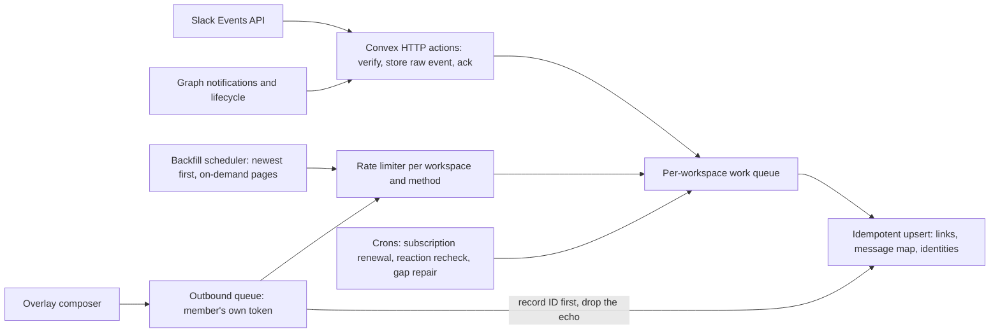

# Slack and Teams sync

Status: In progress. The foundation (data model, Slack live sync into Overlay, link management API), Phase 2 (Slack history and repair), Phase 3 (replying to Slack as yourself) and Phases 4 and 5 (Teams in both directions) are in review; nothing is merged, deployed or accepted yet.

Overlay becomes the hub of a customer's chat: chosen Slack channels and Microsoft Teams channels stay in sync with Overlay channels in both directions, so a team can start using Overlay without everyone leaving Slack or Teams on the same day. This plan builds that on official platform APIs and our existing Convex backend.

Mockup: [mockups/slack-teams-sync.html](mockups/slack-teams-sync.html), built from [mockups/slack-teams-sync.tsx](mockups/slack-teams-sync.tsx) with `node internal/plans/mockups/build-slack-teams-sync.cjs`.

## Progress

| Phase | What ships | State |
| --- | --- | --- |
| 0 | Slack and Microsoft app registrations, Slack Marketplace submission | Not started |
| 1 | Data model and Slack live sync into Overlay | In review (foundation PR), with the Import & sync settings page and Chats source labels in their own PR; not merged, and not yet tested against a live Slack workspace |
| 2 | Rate-limited Slack history backfill and gap repair | In review: shared rate limiter, newest-first history with thread replies, member prioritization, `app_rate_limited` and 429 catch-up, nightly last-day repair and auto-link for new public channels. Not merged; not yet run against a real Slack workspace. Folding the one-time importer onto the sync tables and showing progress in settings are still to do. |
| 3 | Replying from Overlay to Slack as yourself | In review (Phase 3 change, stacked on the foundation): member Slack sign-in, outbox, outbound worker, echo suppression and the "Connect Slack to reply" composer. Covered by unit tests with recorded Slack payloads; not yet tested against a live Slack workspace |
| 4 | Teams live sync and history into Overlay | In review (Teams sync PR): admin consent connect, Teams app package, channel discovery, Graph webhook with subscriptions and renewal cron, polling for private and shared channels, history adapter. The shared history worker registers the adapter separately. Untested against a live tenant until the Phase 0 Entra app and Azure Bot exist |
| 5 | Replying from Overlay to Teams as yourself | In review (Teams sync PR): member sign-in for `ChannelMessage.Send`, sealed tokens with refresh, outbound adapter. The shared outbound worker registers it separately; untested against a live tenant |
| 6 | Opt-in DM sync, attachments, reaction and edit mirroring outward | Partly in review: Slack edits, deletes and reactions mirror outward with Phase 3, and the DM opt-in preference is stored. DM syncing, attachments and the Teams side are not started |
| 7 | Queue-backed ingest for scale (only when the numbers call for it) | Not started |

Nothing above is merged, deployed or accepted.

## Decisions

0. **Reuse the existing Overlay Slack app.** Agents in Slack already run on a multi-workspace Slack app whose installs, encrypted bot tokens and Events API webhook (`/api/v1/webhooks/slack`) are in production, and it already has the history, channel, user and reaction scopes sync needs. Sync adds two bot events (`reaction_added`, `reaction_removed`), a `purpose=sync` OAuth state for workspace-level connects, and later user scopes for replying. This means one Marketplace submission instead of two, and no new Slack secrets. Live Slack events are therefore received by the existing Next.js webhook and applied with `after()`, rather than by a new Convex HTTP route and raw-event table.
1. **Official APIs only.** We use a Slack Marketplace app, a Teams app installed by the customer's admin, and each member's own OAuth sign-in. We do not use browser session tokens (Slack `xoxc-` tokens and `d` cookies) the way Beeper's bridge does. Slack's May 2025 API terms make the Marketplace the only allowed commercial distribution channel, including "templated custom app" instructions, and enterprise security reviews reject servers holding employees' session cookies.
2. **Hub and spoke, one link per channel.** Each Slack or Teams channel links to exactly one Overlay channel, and an Overlay channel links to at most one external channel. We never relay Slack directly to Teams. Apps cannot post as people who have not connected an account, and Teams apps cannot post in shared or private channels, so a direct relay would produce bot-authored copies and echo loops. Ando made the same choice.
3. **Store once per workspace, never per user.** A channel's messages arrive once through the workspace-level install and are stored once, however many Overlay members read them. Members' own tokens are used only to send as themselves and, if they opt in, for their DMs.
4. **Live first, history second.** Live events are pushed by Slack and Microsoft and are never delayed by history import. History imports newest first in the background.
5. **Replace Composio for sync.** The current one-time importer calls Slack through Composio. Sync needs our own app identity, event subscriptions and per-member tokens, so the new code calls Slack and Microsoft Graph directly. The importer's normalizer, message mapping and placeholder-author handling are reused.

## Platform facts this plan relies on

Checked on November 12–13, 2026.

| Fact | Source |
| --- | --- |
| Slack Web API limits apply per method, per workspace, per app. Every token our app holds in a workspace (the bot's and every member's) draws from the same pool. | docs.slack.dev, Rate limits; Slack changelog, March 2018 |
| Slack Events API delivers at most 30,000 events per workspace per app per hour; above that Slack sends `app_rate_limited`. | docs.slack.dev, Rate limits |
| Since May 29, 2025, commercially distributed apps outside the Marketplace get 1 request a minute and 15 messages a page on `conversations.history` and `conversations.replies`. Marketplace apps keep the normal limits (Tier 3, 50+ a minute, up to 1,000 messages a page). | docs.slack.dev changelog, 2025-05-29 |
| Marketplace submission needs 10 active workspaces. The preliminary review takes up to 10 business days, and the functional review up to 10 weeks. | Slack Marketplace review guide |
| Teams message APIs stopped being metered on August 25, 2025. | Microsoft Learn, Metered APIs |
| Installing a Teams app with resource-specific consent (`ChannelMessage.Read.Group`) lets us read and subscribe to a team's channels without Microsoft's protected-API approval for tenant-wide access. | Microsoft Learn, chat message change notifications |
| Graph subscriptions that last longer than an hour need a lifecycle notification URL. Notifications can include encrypted message data, or omit it so the subscriber fetches the message (no certificate needed). | Microsoft Learn, chat message change notifications |
| Graph refuses channel-message subscriptions on private and shared channels when the app uses resource-specific consent (403 "Caller is not allowed to subscribe ... for Shared/Private channel"), though reading them with GET works. We poll those channels instead of requesting tenant-wide `ChannelMessage.Read.All`. | Microsoft Q&A, March 2026; checked November 13, 2026 |
| Teams apps can't post as a user, and can't post in shared or private channels. Posting from Overlay needs each member's delegated `ChannelMessage.Send` grant. | Ando Teams sync docs; Microsoft Graph permissions |

## What exists today

| Piece | Where | Reuse |
| --- | --- | --- |
| One-time Slack import with resume and coverage | `src/server/imports/slack/`, `slackImportJobs`, `slackImportMappings` | Normalizer and author handling. The mapping table grows into the general message map. |
| Import settings tab | `ImportPanel` and `SlackImportPanel` in `src/features/workspaces/components/` | The tab becomes **Import & sync**; one-time import remains a secondary action. |
| Slack webhook for agent-bound threads | `src/app/api/v1/webhooks/slack/route.ts`, `src/server/surfaces/slack-lifecycle.ts` | Kept separate. Channel sync uses its own Convex endpoint and app. |
| Convex HTTP webhooks | Stripe at `/stripe/webhook` | Same pattern for `/slack/events` and `/teams/notifications`. |

## Architecture

### Inbound

1. **Webhook.** A Convex HTTP action checks Slack's signing secret (or Graph's `clientState` and validation token), writes the raw event to `syncInboundEvents` keyed by the platform's event ID, and returns 200 at once. Slack retries anything not acknowledged within 3 seconds, so no other work happens in the request.
2. **Process.** A scheduled mutation reads the raw event, finds the channel link, and upserts the message by its platform ID (Slack `channel + ts`, Graph message ID). Duplicates and retries are harmless. Unknown channels are ignored unless auto-link is on.
3. **Translate.** Mentions (`<@U123>` and Graph `mentions`) become Overlay member mentions or placeholder authors. Slack mrkdwn and Teams HTML convert to our Markdown. Threads map to Overlay thread replies.
4. **Repair.** A nightly job and every `app_rate_limited` notice compare recent history with our copy for linked channels and fill gaps through the rate limiter.

### Outbound

1. A member sends in a linked Overlay channel. The message appears immediately as pending.
2. The outbound job posts with that member's token (Slack `chat.postMessage` with a user token, Graph `POST .../messages` delegated). It writes the returned platform ID into the message map before inbound processing can see the echo, and the echo is dropped by ID.
3. Members without a connected account see "Connect Slack to reply" in the composer for that channel, as Ando does. Agents and system messages are not mirrored outward.

### Backfill

- A link starts in `history` state with the newest page first, back to 180 days.
- Opening a channel and scrolling past loaded history raises that channel's priority.
- Live events, then outbound sends, then repair, then backfill share each workspace's budget in that order.
- Admins can still upload a Slack export ZIP for full history with no API calls (already planned in `internal/develop/external-imports.md`).

### Rate limiter

One limiter, keyed by `provider + workspace + method`, holds the budget for each Slack method or Graph endpoint. It obeys `Retry-After`, starts every non-Marketplace Slack install on the 1-a-minute history budget, and switches to Tier 3 once our app is approved. We'd add Convex's rate-limiter and workpool components; today the backend only uses `@convex-dev/stripe`.

## Data model (Convex)

| Table | Purpose | Key indexes |
| --- | --- | --- |
| `syncConnections` | One per workspace and provider: Slack team or Microsoft tenant ID, bot token reference, scopes, status (connected, paused, disconnected), connected by and when | `by_workspace_provider`, `by_external_org` |
| `syncMemberAccounts` | A member's own Slack or Teams grant: external user ID, encrypted token reference, scopes, DM opt-in | `by_member_provider`, `by_external_user` |
| `syncChannelLinks` | External channel to Overlay conversation: type, state (syncing, history, catching-up, paused), history cursor and percent, pause reason, Graph subscription ID and expiry | `by_conversation` (unique), `by_external_channel` (unique), `by_subscription_expiry` |
| `syncMessageMap` | Platform message ID to Overlay message ID, both directions, with source (inbound or outbound) | `by_external_message`, `by_overlay_message` |
| `syncIdentities` | External user to Overlay member or placeholder author, with display name and avatar | `by_external_user`, `by_member` |
| `syncInboundEvents` | Raw events awaiting processing, kept briefly for retries and debugging | `by_event_id` (unique), `by_status_received` |

Tokens are encrypted and stay on the server. No connector account reference or token is returned to the browser, matching the current `imports/slackBrowse:status` rule.

## Settings experience

The mockup shows **Settings → Workspace → Import & sync**:

- A Slack and Microsoft Teams switch, with one-time import kept as a secondary action.
- **Your Slack workspace / Teams organization:** who connected it and when, plus refresh, app package download (Teams) and disconnect in the menu.
- **Your account:** connect to reply as yourself, then an opt-in **Sync my direct messages** switch that only you see.
- **Channels:** auto-link for new channels (off by default), **Link channel** to choose from channels Overlay can see, and a table of links with Syncing, Importing history (with progress), Catching up (rate limited, resumes automatically) and Paused (with the exact fix) states.
- A one-line health note with live event volume against Slack's hourly limit.

Linked channels then appear in Chats like any other channel, with a small source label. That view is not part of this mockup.

## Capacity model

Assumptions: 1,000 workspaces, 50 people each, about 100 messages, edits and reactions per person per day.

| Quantity | Estimate | Limit or cost |
| --- | --- | --- |
| Events per workspace | about 5,000 a day | Slack allows 30,000 an hour |
| Events overall | about 5 million a day; about 60 a second on average, maybe 300 at peaks | Easy for a webhook ingest |
| Convex function calls | about 300 million a month at two calls per event | About $660 a month at the $2.20 per million listed beyond the included amount; batching lowers it |
| Message storage | about 5 GB a day, nearly 2 TB a year | Keep recent messages in Convex and move older ones to R2 plus a search index |

Risks at scale:

- **Very large workspaces** can pass 30,000 events an hour at busy times. Linking only chosen channels keeps most under it, and repair recovers the rest.
- **DMs** grow with every connected member and share the same hourly cap. They are opt-in per member, and each workspace's event rate is watched.
- **Backfill fairness:** each workspace has its own queue and budget, live work always comes first, and only a fixed number of workspaces backfill at once.

## Phases

### Phase 0: accounts and approvals

- Add the sync events and user scopes to the existing Overlay Slack app (see `internal/develop/surfaces-slack-app.md`), and register a multi-tenant Microsoft Entra app with a Teams app package that requests resource-specific consent.
- Run it on 10 active workspaces (design partners and internal), then submit to the Slack Marketplace. Until approval, history runs at the slow budget.
- Store the client secrets, signing secret and Graph notification certificate in Vercel and Convex environment settings for Preview and Production. Never in the repository.

Exit: both apps installable on a test workspace and tenant; Marketplace submission filed.

### Phase 1: data model and Slack live sync

- Add the tables above and the `/slack/events` Convex HTTP route with signature check and fast acknowledgement.
- Settings: connect Slack, list channels, link and unlink, auto-link switch.
- Process message created, edited, deleted, thread reply and reaction events into linked channels, with placeholder authors.

Exit: on a Preview workspace, messages, edits, deletes, thread replies and reactions posted in a linked Slack channel appear in Overlay within a few seconds. Unlink keeps the Overlay channel and its messages.

### Phase 2: history and repair

- Rate limiter and per-workspace queues; newest-first backfill with on-demand pages; progress shown in settings.
- `app_rate_limited` handling and the nightly gap repair.
- Fold the one-time importer onto the same tables, so imports and sync never create duplicate messages.

Exit: a linked channel with more than 2,000 messages imports 180 days at the slow budget with no duplicates. Forcing a 429 shows Catching up and finishes later on its own.

### Phase 3: replying to Slack

- Member account connection, pending send state, echo suppression, and "Connect Slack to reply" in linked channels.

Exit: a reply from Overlay appears in Slack under the member's name exactly once, and the echo produces no second Overlay message.

### Phase 4: Teams into Overlay

- Teams app install flow, channel discovery per installed team, per-channel Graph subscriptions without resource data (each changed message is fetched), lifecycle notifications, renewal cron, polling for private and shared channels, and history import. Setup: `internal/develop/teams-sync-app.md`.
- Paused states for removed apps and shared or private channels that still need Overlay added.

Exit: the same checks as Phases 1 and 2 on a Microsoft test tenant, including a shared channel.

### Phase 5: replying to Teams

- Delegated `ChannelMessage.Send` per member and the same echo handling.

Exit: as Phase 3 for Teams, including a private channel.

### Phase 6: DMs and richer mirroring

- Opt-in DM sync per member (Slack user-token events, Graph chat subscriptions with delegated access).
- Attachments both ways through our file storage, and outbound edits, deletes and reactions.

### Phase 7: ingest at scale

Only when costs or peak traffic call for it: an edge receiver acknowledges and verifies, writes to a durable queue partitioned by workspace, and a consumer writes to Convex in ordered batches of up to about 100 events per mutation. The rest of the design stays the same.

## QA checklist per phase

- Run `npm run lint` (or targeted ESLint on changed files), `npm run typecheck` and the unit tests for the touched Convex modules.
- On the PR Preview with its own backend, test the full user journey against a test Slack workspace and Microsoft tenant: connect, link, post on each side, edit, delete, thread, react, unlink, disconnect and reconnect.
- Check that nothing in browser network responses contains tokens or connector references.
- Check that the Overlay channel and its history remain after unlink and disconnect.

## Open questions

- Which ten workspaces count toward the Marketplace minimum, and who owns the submission?
- Should a linked private Slack channel let Overlay-only members join, as Ando allows?
- Default history window: 180 days like Ando, or plan-based?
- Pricing: is sync part of paid plans only?

## Docs to update when building

- `internal/develop/external-imports.md` for the shared tables, adapters and the new sync flow.
- `internal/develop/api-route-catalog.md` and `compact-api-route-catalog.md` for any new BFF routes.
- `docs/developer/contribute/local-integrations.mdx` for the local Slack and Microsoft app setup.
